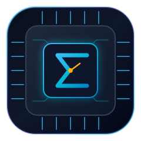
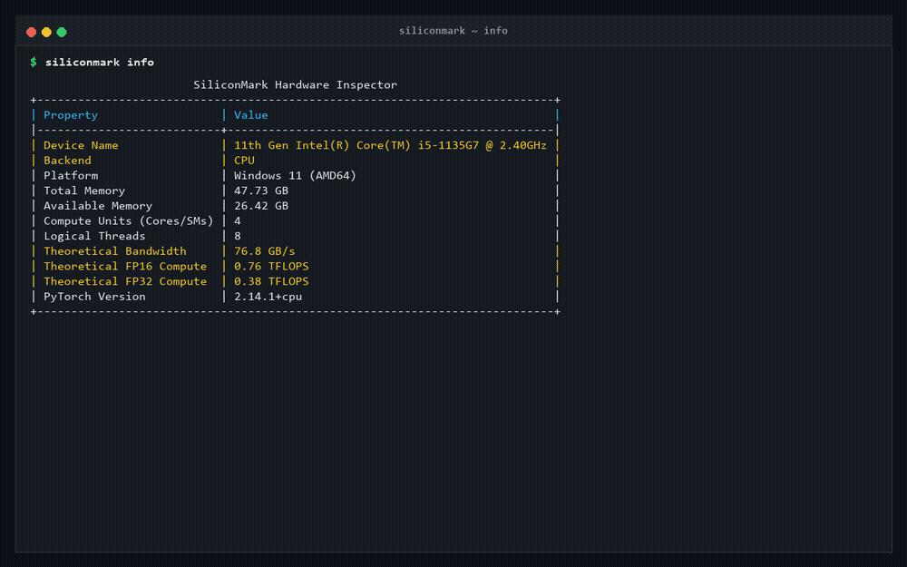
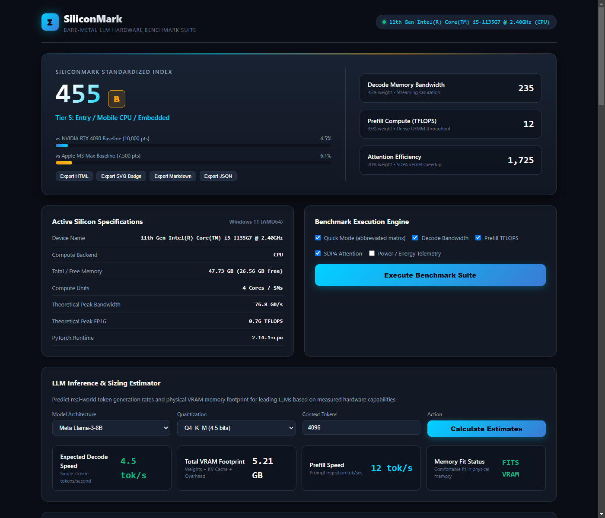
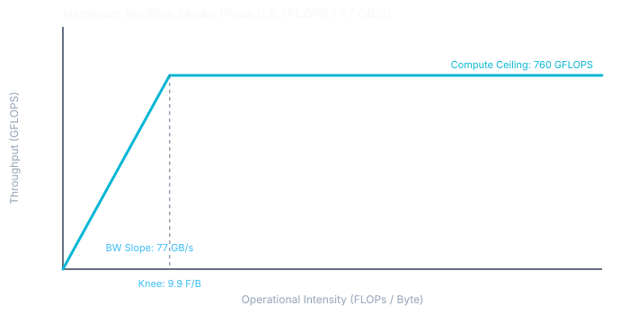

<p align="center">
  
</p>

<h1 align="center">SiliconMark</h1>

<p align="center">
  <strong>Standardized bare-metal hardware benchmark suite measuring LLM prefill TFLOPS, decode memory bandwidth saturation, and attention kernel efficiency.</strong>
</p>

<p align="center">
  <a href="#quickstart">Quickstart</a> &bull;
  <a href="#architecture">Architecture</a> &bull;
  <a href="#roofline-model">Roofline Model</a> &bull;
  <a href="#llm-estimator">LLM Estimator</a> &bull;
  <a href="#cli-reference">CLI Reference</a> &bull;
  <a href="#web-dashboard">Web Dashboard</a> &bull;
  <a href="#test-suite">Tests</a>
</p>

<p align="center">
  
</p>

---

## Overview

Traditional synthetic GPU benchmarks measure rasterization or generic FP32 compute. They do not predict how hardware runs large language models. Large language model execution consists of two distinct physical phases with opposite hardware bottlenecks:

1. **Prompt Prefill Phase**: Compute-bound dense matrix multiplication (GEMM) processing input context in parallel. Performance depends directly on tensor core TFLOPS and compute unit utilization.
2. **Token Generation (Decode) Phase**: Memory bandwidth-bound sequential generation reading full model weights once per token generated ($O(\text{weights})$ bytes moved per single token). Performance is strictly bottlenecked by memory bus bandwidth.

SiliconMark provides calibrated hardware measurements across both phases on bare metal, running authentic PyTorch kernels without synthetic wrappers or mocked figures. It runs on NVIDIA (CUDA), Apple Silicon (MPS), AMD (ROCm), and host CPUs.

---

## Key Capabilities

- **Decode Memory Bandwidth Kernel**: Stride-aligned memory streaming microbenchmarks that measure sustained memory bus throughput and saturation percentage against manufacturer hardware specifications.
- **Prefill Compute Benchmark**: Batched matrix multiplication kernels spanning FP16, BF16, and FP32 to measure sustained floating-point throughput in TFLOPS.
- **Scaled Dot-Product Attention (SDPA) Benchmark**: Measures flash attention and memory-efficient kernel throughput against un-fused naive attention across varying sequence lengths and context windows.
- **Context Length Scaling Curve**: Measures attention execution, KV-cache footprint, and scaling degradation from 1K to 64K+ token windows, assigning an efficiency scaling grade.
- **Quantized Kernel Microbenchmark**: Evaluates authentic INT8 scaled GEMM/GEMV and packed INT4 dequantization streaming throughput (TOPS) and speedups over floating point baselines.
- **Power and Energy Telemetry**: Real-time power sampling measuring Watts, Joules consumed, Tokens per Joule, and TFLOPS per Watt.
- **Multi-Device & Interconnect Benchmark**: Evaluates Peer-to-Peer (P2P) memory copy bandwidth (GB/s) and All-Reduce collective synchronization latency across multi-accelerator rigs and host interconnects.
- **Hardware Roofline Model**: Calculates machine balance ($I_{\text{knee}} = \text{Peak GFLOPS} / \text{Peak Bandwidth GB/s}$) and classifies operational intensity into bandwidth-bound and compute-bound regimes.
- **LLM Sizing and Latency Estimator**: Computes weight memory, KV cache footprint ($2 \times n_{\text{layers}} \times d_{\text{kv}} \times n_{\text{ctx}} \times \text{dtype}$), decode tokens per second, and time-to-first-token (TTFT) across quantized formats (FP16, Q8_0, Q4_K_M, Q2_K).
- **Calibrated Scoring Engine**: Standardized 0 to 10,000+ point scoring index calibrated against an NVIDIA GeForce RTX 4090 desktop baseline (10,000 points) and Apple M3 Max (7,500 points).
- **Interactive Web Dashboard and REST API**: FastAPI backend providing hardware telemetry, live test execution, interactive charts, and model sizing calculators.
- **Standalone HTML and Dynamic Badge Exporters**: Exports standalone responsive HTML reports and shields.io-compatible vector SVG score badges.

---

<p align="center">
  
</p>

---

## Core Benchmark Metrics

| Metric | Phase | Physical Formula | Bottleneck |
| :--- | :--- | :--- | :--- |
| **Decode Bandwidth** | Token Generation | $\text{Bytes Read} / \Delta t$ (GB/s) | Memory bus throughput |
| **Prefill Throughput** | Prompt Ingestion | $2 \times M \times N \times K / \Delta t$ (TFLOPS) | Tensor core compute density |
| **Attention Kernel** | Attention Blocks | $4 \times B \times H \times S^2 \times D / \Delta t$ | SRAM reuse and kernel fusion |
| **Machine Balance** | Roofline Knee | $\text{Peak TFLOPS} / \text{Peak Bandwidth}$ | Architectural inflection |
| **Energy Efficiency** | Sustained Inference | $\text{Tokens} / \text{Joules}$ or $\text{TFLOPS} / \text{Watt}$ | Power draw & thermal throttling |

---

## Roofline Model

The Roofline model couples achievable throughput with operational intensity (FLOPs per byte moved). SiliconMark calculates the exact balance knee point for the detected silicon.

<p align="center">
  
</p>

```
========================= ROOFLINE MODEL SUMMARY =========================
Peak Compute:     0.76 TFLOPS (760.0 GFLOPS)
Peak Bandwidth:   76.8 GB/s
Machine Balance:  9.90 FLOPs/Byte (knee point)

Operational Regimes:
  < 9.90 FLOPs/Byte  -> Memory Bandwidth Bound (Token Decode, GEMV)
  >= 9.90 FLOPs/Byte -> Compute Core Bound (Prompt Prefill, Dense GEMM)
==========================================================================
```

---

## Installation

### Prerequisites

- Python 3.10, 3.11, or 3.12
- PyTorch 2.1 or newer (CPU, CUDA, MPS, or ROCm builds)

### Setup

```bash
# Clone the repository
git clone https://github.com/alexandrmotologa/siliconmark.git
cd siliconmark

# Create virtual environment
python -m venv .venv

# Activate on Linux/macOS
source .venv/bin/activate
# Activate on Windows
.venv\Scripts\activate

# Install SiliconMark with development dependencies
pip install -e ".[dev]"
```

---

## CLI Reference

SiliconMark exposes a comprehensive CLI with formatted terminal output via Typer and Rich.

### 1. Hardware Inspection

Inspect available silicon, memory buses, compute units, and theoretical limits:

```bash
siliconmark info
```

### 2. Run Benchmarks

Run the standard suite, quick validation pass, or include real-time power telemetry:

```bash
# Run quick benchmark pass
siliconmark run --quick

# Run with real-time power and energy profiling
siliconmark run --quick --power

# Export results to HTML, Markdown, and dynamic SVG badge
siliconmark run --quick --output benchmark_report.html --badge score_badge.svg
```

### 3. Context Length Scaling

Measure kernel throughput and KV-cache footprint degradation across context lengths:

```bash
siliconmark context-scaling --quick --svg context_curve.svg
```

### 4. Quantized Kernel Microbenchmark

Benchmark INT8 and packed INT4 matrix-vector (GEMV) and GEMM execution:

```bash
siliconmark quantized --quick
```

### 5. Multi-Device & Interconnect

Benchmark Peer-to-Peer (P2P) copy throughput and All-Reduce latency:

```bash
siliconmark interconnect
```

### 6. Roofline Analysis

Generate terminal diagrams or export standalone SVG charts:

```bash
siliconmark roofline --svg roofline_chart.svg
```

### 7. Real-World LLM Inference Estimator

Calculate expected tokens per second and memory footprint for open-weight models:

```bash
siliconmark estimate --model llama-3-8b --quant q4_k_m --context 4096
siliconmark estimate --model llama-3-70b --quant q4_k_m --context 8192
```

### 8. Compare Hardware

Compare benchmark runs side by side against reference hardware or previous runs:

```bash
siliconmark compare latest rtx4090
siliconmark compare latest m3max
```

### 9. Export Reports & Badges

Convert any existing run to standalone HTML, Markdown, JSON, or SVG badge:

```bash
siliconmark export latest --format html --output report.html
siliconmark export latest --format badge --output badge.svg
```

### 10. Web Dashboard Server

Start the interactive browser dashboard and REST API server:

```bash
siliconmark serve --host 127.0.0.1 --port 8000
```

Open `http://localhost:8000` to access the dashboard.

---

## Standardized Scoring Calibration

The SiliconMark Score combines decode bandwidth (45%), prefill TFLOPS (35%), and attention efficiency (20%) normalized against an NVIDIA GeForce RTX 4090 reference run.

$$\text{Score} = 10{,}000 \times \left( 0.45 \times \frac{\text{BW}_{\text{sustained}}}{800} + 0.35 \times \frac{\text{TFLOPS}_{\text{sustained}}}{165} + 0.20 \times \frac{\text{Attn}_{\text{score}}}{10{,}000} \right)$$

### Hardware Classification Tiers

| Tier | Score Range | Typical Hardware |
| :--- | :--- | :--- |
| **Tier 1: Frontier Accelerator** | 15,000+ | NVIDIA H100, B200, AMD MI300X |
| **Tier 2: Enthusiast / Workstation** | 8,000 - 14,999 | NVIDIA RTX 4090, RTX 5090, RTX 6000 Ada |
| **Tier 3: Unified High-Bandwidth SoC** | 4,000 - 7,999 | Apple M3 Max, M4 Pro, RTX 4080 |
| **Tier 4: Mid-Range Consumer GPU** | 1,500 - 3,999 | Apple M3 Pro, RTX 4070, RX 7800 XT |
| **Tier 5: Entry / Mobile CPU / Embedded** | < 1,500 | Intel Core Ultra, AMD Ryzen APU, Apple M3 |

---

## REST API Endpoints

When running `siliconmark serve`, the following endpoints are exposed:

- `GET /api/system`: Probed hardware device parameters and limits.
- `GET /api/chips`: Reference specifications for comparison GPUs and SoCs.
- `GET /api/roofline`: Computed roofline parameters, knee point, and SVG diagram.
- `GET /api/models`: Catalog of supported LLM architectures and quantization sizes.
- `POST /api/estimate`: Calculate memory footprint and inference speed for specific configurations.
- `POST /api/benchmarks/run`: Trigger asynchronous benchmark execution.
- `POST /api/context-scaling`: Run context window scaling sweep with SVG chart.
- `POST /api/quantized`: Run INT8 and packed INT4 kernel microbenchmarks.
- `GET /api/interconnect`: Evaluate P2P memory copy and collective synchronization.
- `GET /api/compare`: Retrieve side-by-side comparison between two runs.
- `GET /api/status`: Poll status of ongoing or completed benchmark runs.
- `GET /api/runs`: List historical benchmark JSON records.
- `GET /api/runs/{run_id}/html`: Download standalone interactive HTML report.
- `GET /api/runs/{run_id}/badge`: Download vector SVG score badge.
- `GET /api/runs/{run_id}/markdown`: Retrieve benchmark summary formatted as Markdown.

---

## Test Suite

SiliconMark includes comprehensive unit and integration tests covering configuration validation, memory bandwidth calculations, GEMM prefill, SDPA kernels, context length scaling, quantization kernels, power telemetry, interconnect, scoring calibration, CLI invocation, and FastAPI routes.

```bash
pytest -v
```

All 50 test cases pass on standard Python 3.10+ environments.

---

## License

This project is licensed under the MIT License. See [LICENSE](LICENSE) for details.
